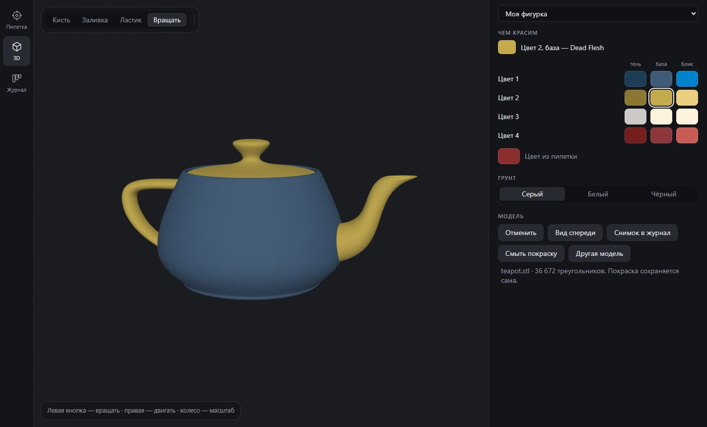

# Paint Picker

Помощник для тех, кто печатает фигурки и красит их. Берёт цвет с фото, подбирает под него краски, собирает палитру на всю фигурку, даёт примерить её на 3D-модели и ведёт журнал проектов.



## Скачать

[**PaintPicker-Setup.exe**](https://github.com/LeoDex0/paint-picker/releases/latest/download/PaintPicker-Setup.exe) — установщик для Windows, около 100 МБ.

При первом запуске Windows покажет окно «Система Windows защитила ваш компьютер», потому что файл не подписан. Нажми «Подробнее», затем «Выполнить в любом случае».

Версия без установки лежит на [странице релизов](https://github.com/LeoDex0/paint-picker/releases/latest).

## Что умеет

### Пипетка

- Фото можно перетащить в окно, вставить через Ctrl+V или выбрать файлом. Клик берёт цвет, колесо меняет масштаб, правая кнопка двигает фото.
- **Совпадения.** Ближайшие краски с процентом совпадения, а над списком — краска для тени и для блика, чтобы красить с объёмом.
- **Наборы красок.** Vallejo (Game Color, Model Color, Game Air, Model Air), Citadel (Base и Layer), Army Painter (Warpaints и Warpaints Fanatic), AK 3rd Gen — всего около 1460 красок. Включаются кнопкой «Набор» над списком.
- **Аналоги.** Клик по любой краске показывает самые похожие краски в остальных наборах.
- **Рецепт.** Подбирает смесь из двух-трёх красок, отмеченных во вкладке «Мои»: сколько частей каждой взять и какой цвет выйдет.
- **Палитра.** Кнопка «+ В палитру» складывает цвета фигурки в проект. Для каждого цвета видно основную краску, тень и блик, а внизу — список «Докупить», который можно скопировать.

### 3D

Загружаешь STL своей фигурки и красишь её красками из палитры: кистью или заливкой до изгиба поверхности. Можно сменить цвет грунта, отменить мазок (Ctrl+Z) и сохранить снимок в журнал. Модель и покраска хранятся в проекте.

### Журнал

Доска проектов по стадиям: в очереди, напечатано, загрунтовано, покрашено. Карточки перетаскиваются между колонками. У проекта есть фото, палитра и заметки; любое фото можно открыть в пипетке.

## Насколько этому верить

- Цвет на фото зависит от освещения и камеры. Снимай при дневном свете и бери средний тон, а не блик или тень.
- Процент показывает сходство с цифровым образцом краски. На модели оттенок ещё зависит от грунта и числа слоёв.
- Рецепт приблизительный: он считается по цвету образцов, настоящих данных о пигментах нет. Смешай пару капель на пробу и подправь на глаз.
- Металлики помечены и в рецептах не участвуют: блеск одним цветом не описать. Смывок, контрастных красок и грунтов в базе нет.
- 3D-примерка показывает раскладку цветов, а не фактуру краски.

## Где хранятся данные

Всё лежит на компьютере пользователя, в профиле приложения: отмеченные краски и проекты, фото и 3D-модели. В интернет приложение не ходит.

## Запуск из исходников

Нужен Node.js 22 или новее.

```
npm install
npm start
```

## Сборка

```
npm run dist
```

В папке `dist` появятся `PaintPicker-Setup.exe` (установщик) и `PaintPicker-Portable.exe` (работает без установки, но каждый запуск распаковывается секунд пятнадцать).

## Откуда данные

- Цвета красок — [miniature-paints](https://github.com/Arcturus5404/miniature-paints), MIT. База пересобирается командой `node scripts/build-paints.js папка_с_таблицами`.
- Спектральные таблицы для смешивания — [spectral.js](https://github.com/rvanwijnen/spectral.js), MIT.
- 3D — [three.js](https://github.com/mrdoob/three.js) и [three-mesh-bvh](https://github.com/gkjohnson/three-mesh-bvh), MIT.

Тексты лицензий лежат в `THIRD-PARTY.md`.
